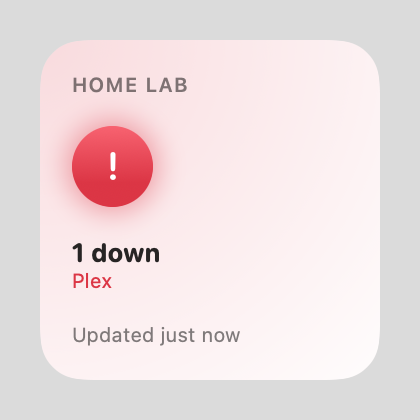
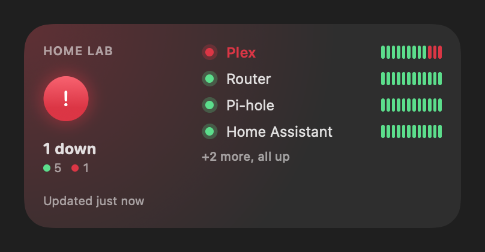
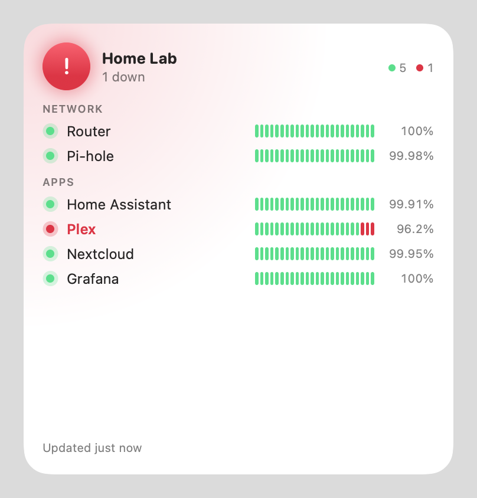

# uptime-kuma-widget

[](https://github.com/dewab74/uptime-kuma-widget/actions/workflows/ci.yml)
[](https://github.com/dewab74/uptime-kuma-widget/actions/workflows/pre-commit.yml)

**Kuma Status** is a macOS desktop widget, with a small menu bar companion,
that mirrors an [Uptime Kuma](https://github.com/louislam/uptime-kuma) status
page. It shows what is up and what is down without opening a browser.

<p>
  
  
</p>


## Status

**Early development (0.1.0, unreleased).** Built and checked against a mock
of the Uptime Kuma 1.23 and 2.x status page API. Not affiliated with or
endorsed by the Uptime Kuma project.

## What you get

- **Widget** in three sizes, for the desktop or Notification Center:
  - *Small*: the overall verdict and the names of whatever is down.
  - *Medium*: the verdict, counts, and the most urgent monitors with their
    recent heartbeats.
  - *Large*: monitors grouped as on your status page, with heartbeat bars and
    24-hour uptime. Groups with problems come first, and the worst monitors
    lead each group. Shows a pinned incident or active maintenance.
  - Light and dark. Data older than three poll
    intervals (at least 5 minutes) is dimmed and marked offline, so a dead
    server is never shown as green.
  - Clicking the widget opens the status page in your browser.
- **Menu bar app**: an icon that shows the overall state and the number of
  problems, and a popover with the full list, problems first. You set the
  server here.
- **Display settings**: choose which statuses the lists show (Up, Pending,
  Maintenance, No data), or click **Problems Only**. Down monitors are always
  listed, and the headline and counts always cover every monitor.

## How it stays current

A macOS widget cannot run its own timer: WidgetKit decides when it refreshes,
usually every 15 minutes or so. So the menu bar app does the polling:

1. Every poll interval (default 60 s) it reads the status page through Kuma's
   public API, the same two requests the web status page makes:
   `/api/status-page/<slug>` and `/api/status-page/heartbeat/<slug>`. No login
   or API key is needed. Kuma caches the heartbeat answer for 60 s, so polling
   faster than that gets the same data back.
2. It writes the result to a file in an App Group container shared with the
   widget.
3. When a monitor changes state (or the server becomes unreachable, or
   recovers) it tells WidgetKit to redraw now. Ping times and uptime drift
   wait for the widget's own schedule, so routine polls do not spend the
   widget's refresh budget.

If the app is not running, the widget fetches by itself when WidgetKit asks
it for a new timeline, so it still updates, only less often.

Only monitors on a **published status page** are visible this way. To watch a
monitor, add it to a status page (it can be a page you never share).

## Requirements

- macOS 14 Sonoma or later.
- Uptime Kuma 1.23 or 2.x with a published status page.
- To build from source: Xcode 16 or later and
  [XcodeGen](https://github.com/yonaskolb/XcodeGen).

## Install

Once a release is out, download `kuma-status-<version>.zip` from the
[latest release](https://github.com/dewab74/uptime-kuma-widget/releases/latest)
(check it against the `.sha256` beside it), unzip it, and move
`Kuma Status.app` to `/Applications`. The app is signed with a development
certificate but not notarized, so macOS blocks the first open: choose
**System Settings › Privacy & Security › Open Anyway**.

Or build it yourself (needs Xcode 16+ and `brew install xcodegen`):

```bash
git clone https://github.com/dewab74/uptime-kuma-widget.git
cd uptime-kuma-widget
cp Config/Signing.example.xcconfig Config/Signing.xcconfig
```

Put your team id in `Config/Signing.xcconfig` (the comment in it shows how to
find it; a free Apple ID's personal team works), then:

```bash
scripts/build.sh --release
```

and use `artifacts/Kuma Status.app`.

## Set up

Open the app. On the first run it opens Settings at **Connection**:

- **URL**: your Kuma address, with its port if it is not on 80/443, e.g.
  `https://status.example.com` or `http://kuma.lan:3001`. You can paste a
  whole status page link (`https://status.example.com/status/home`) and the
  slug is filled in for you.
- **Status page**: the slug, the last part of the page's link.
- **Verify TLS certificate**: leave on. Turn it off only for a Kuma with a
  self-signed or private-CA certificate your Mac does not trust; the
  connection stays encrypted, but the server's identity is not checked.
- **Check every**: 30 s to 10 min.
- **Open at login**: recommended, so the widget stays current.

Use **Test** to check the address, then **Save**. Then right-click the
desktop, choose **Edit Widgets…**, search for **Uptime Kuma** and add a size.

Plain `http://` addresses work, for Kuma on a LAN. macOS may ask once for
permission to reach devices on your local network.

## Privacy and security

The app talks only to the server you enter, with unauthenticated `GET`
requests to the public status page API. It stores the address and the last
result locally, in its App Group container. No credentials are used (Kuma's
status page API has none; its API keys only cover `/metrics`), and nothing is
sent anywhere else. Turning off **Verify TLS certificate** skips certificate
checks for that one host only. The app and widget are sandboxed with outgoing
network access only. See [SECURITY.md](SECURITY.md).

## Development

See [CONTRIBUTING.md](CONTRIBUTING.md) for the full setup. In short:

```bash
pre-commit install          # once per clone: lint and secret scanning on commit
swift test --package-path Packages/KumaKit
scripts/build.sh            # Debug build, signed if Config/Signing.xcconfig exists
open KumaStatus.xcodeproj   # generated by build.sh from project.yml
```

| Path | What it is |
| --- | --- |
| `Packages/KumaKit/Sources/KumaKit` | Models, API client, poller, shared state. No UI; fully tested. |
| `Packages/KumaKit/Sources/KumaUI` | SwiftUI drawn by both the widget and the app, including all widget layouts. |
| `Packages/KumaKit/Sources/kuma-render` | Development tool: renders the widget sizes to PNG. |
| `App/` | Menu bar app: poll loop, popover, settings. |
| `Widget/` | WidgetKit extension: a thin timeline provider around `KumaUI`. |
| `project.yml` | XcodeGen spec; the `.xcodeproj` is generated and not committed. |

Render the widget without installing it, from sample data or a live page:

```bash
swift run --package-path Packages/KumaKit kuma-render /tmp/widgets
swift run --package-path Packages/KumaKit kuma-render /tmp/widgets https://status.example.com home
swift run --package-path Packages/KumaKit kuma-render --hide up,maintenance /tmp/widgets   # as Display settings
```

Design notes and decisions: [docs/design.md](docs/design.md).

## License

[MIT](LICENSE).
